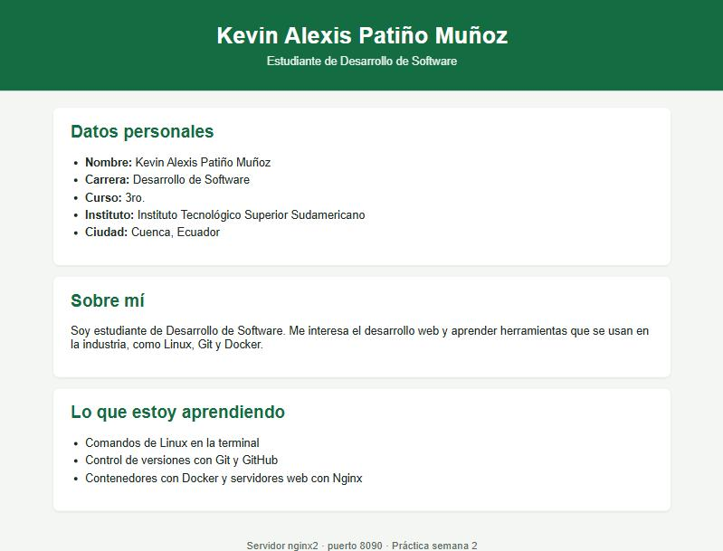

<div align="center">

# INSTITUTO TECNOLÓGICO SUPERIOR SUDAMERICANO

<br>

**AUTOR:** KEVIN ALEXIS PATIÑO MUÑOZ

**MATERIA:** TENDENCIAS TECNOLÓGICAS

**DOCENTE:** ING. MARCO AURELIO GUAMÁN BUESTÁN

**CURSO:** 3RO.

**CARRERA:** “DESARROLLO DE SOFTWARE”

**TEMA:** TAREA AUTÓNOMA SEMANA 2 – SERVIDORES WEB NGINX CON DOCKER

**FECHA DE ELABORACIÓN:** 19/10/2026

**FECHA DE ENTREGA:** 19/10/2026

<br><br>

**CUENCA - ECUADOR**

**2026**

</div>

---

## 1. Título

**Práctica No. 2: Crear y personalizar dos servidores web con Nginx usando Docker**

## 2. Tiempo de duración

90 minutos.

## 3. Fundamentos

**Docker** es una plataforma de código abierto que permite empaquetar una aplicación junto con todo lo que necesita para funcionar (librerías, dependencias y configuración) en una unidad llamada **contenedor**. Gracias a esto, una aplicación se ejecuta igual en la computadora del desarrollador, en un servidor de pruebas o en la nube, lo que evita el clásico problema de “en mi máquina sí funciona”.

**Imagen y contenedor.** Una **imagen** es una plantilla de solo lectura que contiene un sistema de archivos mínimo y la aplicación lista para ejecutarse. Las imágenes se descargan de un registro público llamado **Docker Hub**. Un **contenedor** es una instancia en ejecución de una imagen: a partir de una sola imagen se pueden crear muchos contenedores independientes, cada uno con su propio nombre, red y sistema de archivos. En esta práctica, a partir de la imagen `nginx` se crean dos contenedores distintos: `nginx1` y `nginx2`.

**Contenedores frente a máquinas virtuales.** Una máquina virtual necesita un sistema operativo completo, por lo que consume mucha memoria y tarda en arrancar. Un contenedor comparte el núcleo (kernel) del sistema anfitrión y solo aísla los procesos, así que arranca en segundos y ocupa mucho menos espacio.

**Nginx** es un servidor web de alto rendimiento. También se usa como proxy inverso y balanceador de carga. En la imagen oficial, Nginx escucha en el **puerto 80** dentro del contenedor y sirve los archivos ubicados en la carpeta `/usr/share/nginx/html`. El archivo `index.html` de esa carpeta es la página que aparece al entrar al servidor.

**Mapeo de puertos.** Cada contenedor tiene su propia red aislada, así que para acceder a él desde el navegador del anfitrión hay que publicar un puerto con la opción `-p puerto_anfitrion:puerto_contenedor`. Con `-p 8089:80`, todo lo que llega al puerto 8089 de la computadora se redirige al puerto 80 del contenedor. Por eso se pueden tener dos servidores Nginx al mismo tiempo: ambos usan el puerto 80 internamente, pero se publican en puertos distintos del anfitrión (8089 y 8090).

**Comandos utilizados:**

| Comando | Función |
|---------|---------|
| `docker run -d --name <nombre> -p <host>:<cont> <imagen>` | Crea y arranca un contenedor en segundo plano (`-d`), con nombre y puerto publicado |
| `docker ps` | Lista los contenedores en ejecución |
| `docker cp <contenedor>:<ruta> <destino>` | Copia archivos entre el contenedor y el anfitrión (en ambos sentidos) |
| `nano <archivo>` | Editor de texto en la terminal |
| `docker stop` / `docker rm` | Detiene / elimina un contenedor |

El comando `docker cp` permite modificar el contenido de un contenedor sin entrar en él: se copia el archivo al anfitrión, se edita con cualquier editor y se vuelve a copiar a su ruta original. Nginx sirve el archivo nuevo de inmediato, sin necesidad de reiniciar el contenedor.

## 4. Conocimientos previos

- Comandos básicos de Linux (`ls`, `cd`, `cp`, `mv`) vistos en la semana 1.
- Uso de un editor de texto en la terminal (`nano` o `vi`).
- Estructura básica de un documento HTML.
- Manejo del navegador web y concepto de puerto de red.

## 5. Objetivos

- Desplegar dos contenedores Docker a partir de la imagen oficial de Nginx.
- Publicar cada servidor en un puerto distinto del anfitrión (8089 y 8090).
- Copiar archivos entre el contenedor y el anfitrión con `docker cp`.
- Personalizar el `index.html` de cada servidor: información institucional en `nginx1` e información personal en `nginx2`.

## 6. Equipo necesario

- Computador con Windows 11 (también válido Linux o macOS).
- Docker Desktop (Docker Engine 29.8.1).
- Imagen oficial `nginx:latest` (Nginx 1.31.7).
- Git Bash como terminal y `nano` como editor.
- Navegador web.

## 7. Material de apoyo

- Guía de la asignatura Tendencias Tecnológicas y video guía de la práctica.
- Plantilla del informe: <https://github.com/maguaman2/informe-tendencias>
- Documentación de Docker: <https://docs.docker.com/>
- Imagen oficial de Nginx en Docker Hub: <https://hub.docker.com/_/nginx>
- Cheat sheet de comandos Linux.

## 8. Procedimiento

### 8.1 Crear el primer contenedor `nginx1` en el puerto 8089

```bash
docker run -d --name nginx1 -p 8089:80 nginx
```

Como la imagen no estaba en el equipo, Docker la descargó de Docker Hub y luego creó el contenedor. El resultado es el ID del contenedor:

```text
190d7ed30bd4b82019dad4e1f01505eedb60979cc0cdf5d1b4d733c31a1b9531
```

### 8.2 Crear el segundo contenedor `nginx2` en el puerto 8090

```bash
docker run -d --name nginx2 -p 8090:80 nginx
```

Se verifica que ambos estén en ejecución:

```bash
docker ps
```

**Figura 1.** Contenedores `nginx1` y `nginx2` en ejecución

```text
CONTAINER ID   IMAGE   NAMES    STATUS         PORTS
211292c29fcc   nginx   nginx2   Up 2 seconds   0.0.0.0:8090->80/tcp, [::]:8090->80/tcp
190d7ed30bd4   nginx   nginx1   Up 6 seconds   0.0.0.0:8089->80/tcp, [::]:8089->80/tcp
```

En este punto, al abrir `http://localhost:8089` y `http://localhost:8090` aparece la página por defecto “Welcome to nginx!”.

### 8.3 Copiar el `index.html` de `nginx1` al anfitrión

```bash
docker cp nginx1:/usr/share/nginx/html/index.html ./index1.html
```

### 8.4 Editar `index1.html` con información institucional

```bash
nano index1.html
```

Se reemplazó el contenido por defecto con una página del **Instituto Tecnológico Superior Sudamericano**: descripción del instituto, la carrera de Desarrollo de Software y la asignatura. El archivo completo está en [`index1.html`](index1.html).

### 8.5 Copiar el archivo editado de vuelta a `nginx1`

```bash
docker cp index1.html nginx1:/usr/share/nginx/html/index.html
```

### 8.6 Repetir el proceso para `nginx2` con información personal

```bash
docker cp nginx2:/usr/share/nginx/html/index.html ./index2.html
nano index2.html
docker cp index2.html nginx2:/usr/share/nginx/html/index.html
```

En `index2.html` se colocaron los datos personales del estudiante, una breve presentación y los temas que está aprendiendo. El archivo completo está en [`index2.html`](index2.html).

## 9. Resultados esperados

Al abrir cada puerto en el navegador se muestra el contenido personalizado, servido por un contenedor distinto.

**Figura 2.** Servidor `nginx1` en `http://localhost:8089` con información institucional


**Figura 3.** Servidor `nginx2` en `http://localhost:8090` con información personal



Con esta práctica se comprobó que:

- A partir de una sola imagen se pueden crear varios contenedores independientes.
- Dos contenedores pueden usar el mismo puerto interno (80) si se publican en puertos distintos del anfitrión.
- `docker cp` permite sacar, editar y devolver archivos a un contenedor, y Nginx muestra los cambios sin reiniciarse.

Estructura del repositorio:

```text
tarea-s2-nginx-docker/
├── README.md
├── index1.html
├── index2.html
└── img/
    ├── nginx1.jpg
    └── nginx2.jpg
```

## 10. Bibliografía

- Docker Inc. (2026). *Docker documentation*. <https://docs.docker.com/>
- Docker Inc. (2026). *docker container cp*. Docker Docs. <https://docs.docker.com/reference/cli/docker/container/cp/>
- Docker Hub. (2026). *nginx – Official image*. <https://hub.docker.com/_/nginx>
- F5, Inc. (2026). *nginx documentation*. <https://nginx.org/en/docs/>
